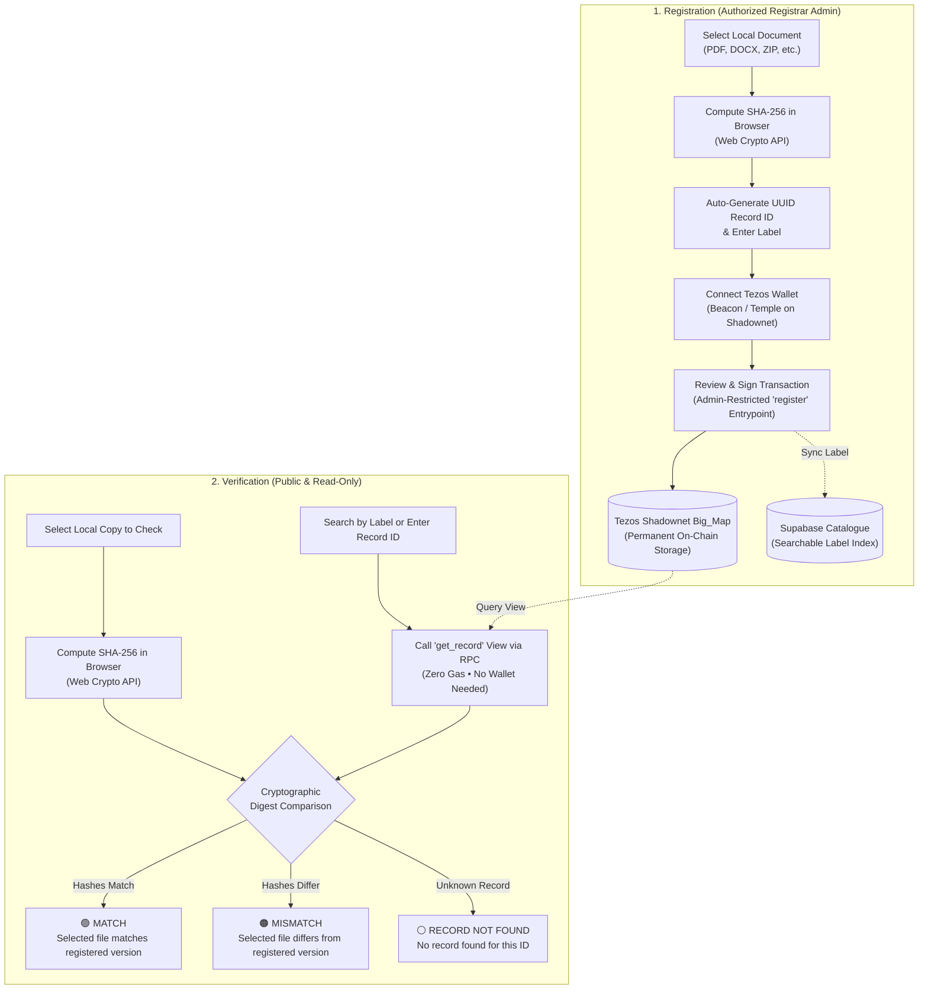

# D.A.R.T – Decentralized Authentication and Record Tracking

[](https://teztnets.com/shadownet-about)
[](https://smartpy.io)
[](https://tezostaquito.io)
[](https://walletbeacon.io)
[](https://supabase.com)
[](https://www.typescriptlang.org)
[](https://vitejs.dev)
[]()

> **Decentralized document integrity registry for student clubs, research groups, and project teams.**  
> Verify document revisions and establish immutable cryptographic proof on Tezos Shadownet without uploading files or exposing private data.

---

## Table of Contents

- [Overview & Core Guarantees](#overview--core-guarantees)
- [Key Features](#key-features)
- [How It Works](#how-it-works)
  - [Cryptographic Architecture Flow](#cryptographic-architecture-flow)
- [Verification Outcomes](#verification-outcomes)
- [Technical Architecture](#technical-architecture)
  - [Smart Contract Specification](#smart-contract-specification)
  - [Tezos & Beacon Wallet Flow](#tezos--beacon-wallet-flow)
  - [Supabase Catalogue Integration](#supabase-catalogue-integration)
  - [Visual System & Dark Mode](#visual-system--dark-mode)
- [Security & Trust Boundaries](#security--trust-boundaries)
- [Getting Started](#getting-started)
  - [Prerequisites](#prerequisites)
  - [Installation](#installation)
  - [Configuration](#configuration)
  - [Development Server](#development-server)
  - [Testing & Quality Assurance](#testing--quality-assurance)
  - [Production Build](#production-build)
- [Repository Structure](#repository-structure)
- [License](#license)

---

## Overview & Core Guarantees

When student organizations and project teams distribute bylaws, contest entries, whitepapers, financial statements, or code archives, team members and evaluators frequently need to confirm that a circulating copy matches the authoritative version approved by the leadership.

**D.A.R.T** addresses this challenge with five core architectural guarantees:

1. **100% Client-Side Privacy (Zero File Uploads)**  
   The selected document never leaves the user's browser. Files are read locally via the HTML5 File API and digested in memory with the W3C Web Crypto API (`crypto.subtle.digest('SHA-256')`). No file bytes are ever uploaded, cached, or transmitted to any server, IPFS node, or blockchain.
2. **Authoritative On-Chain Anchor**  
   Only the 64-character lowercase hexadecimal SHA-256 fingerprint, a human-readable document label, an auto-generated UUID v4 Record ID, the registrar's address, and the on-chain timestamp are committed to the SmartPy smart contract storage on **Tezos Shadownet**.
3. **Wallet-Free Public Verification**  
   Checking a document is completely read-only and publicly accessible. Anyone can inspect and verify a file in seconds without connecting a wallet, installing a browser extension, holding testnet tez, or paying transaction fees.
4. **Convenient Label-Based Discovery**  
   Users can look up documents by searching their familiar label (with live autocomplete, masked sensitive identifiers, and duplicate warnings), eliminating the need to memorize or paste raw UUID record strings.
5. **Decentralized Access Enforcement**  
   Document registration is strictly restricted on-chain to the smart contract's configured administrator wallet address.

---

## Key Features

- **Standardized Wallet Flow**: Universal "Connect Wallet" flow powered by Beacon and Taquito, allowing users to select Temple or any supported Tezos wallet with "Use Extension" pairing.
- **Persistent Session Control**: Explicit wallet disconnect choices persist across page reloads so browser extensions do not auto-reconnect without user interaction.
- **Reload-to-Top Navigation**: True page reloads (Ctrl+R / browser refresh) return to the top of the page while maintaining standard scroll restoration for browser Back/Forward and anchor links.
- **Radial View Transitions Dark Mode**: Seamless toggle between a crisp Light Mode and an elegant Dark Mode featuring an expanding circular radial reveal via the View Transitions API, with smooth fallback and `prefers-reduced-motion` compliance.
- **Refined Micro-Interactions**: Visual navbar hover enlargement (3.5%) animating text labels and brand icons without causing layout shifts.
- **Registration Requirements Assistant**: Automatic prerequisite verification before transaction submission, displaying clear, actionable buttons if wallet connection or catalogue sign-in is required.
- **Confirmed Transaction Explorer Link**: Verified document registrations provide a direct external link to the TzKT Shadownet Block Explorer (`https://shadownet.tzkt.io/{TX_HASH}`) for independent on-chain audit.

---

## How It Works

### Cryptographic Architecture Flow



---

## Verification Outcomes

The verification engine compares the browser-computed SHA-256 digest against the on-chain record returned by `get_record(record_id)` and presents exactly one of three clear outcomes:

| Outcome | Visual Status | What It Means |
| :--- | :--- | :--- |
| **MATCH** | 🟢 **MATCH** | The selected file's calculated SHA-256 digest is **identical** to the fingerprint registered on Tezos Shadownet for that Record ID. |
| **MISMATCH** | 🟠 **MISMATCH** | A valid registration exists on-chain for this Record ID, but the selected file's SHA-256 digest **differs**. The file has been modified or does not match the registered version. |
| **RECORD NOT FOUND** | ⚪ **RECORD NOT FOUND** | No registration exists on Tezos Shadownet for the supplied Record ID. *(An unknown ID is never classified as a mismatch.)* |

---

## Technical Architecture

```
┌────────────────────────────────────────────────────────────────────────┐
│                        Browser Client (React 18 + Vite)                │
│                                                                        │
│  [UI Components] ──▶ [Web Crypto API]  ──▶ Local SHA-256 Digest       │
│         │                                                              │
│         ├──▶ [tezosAdapter.ts] ───────▶ Taquito / Beacon / Temple      │
│         │                                                              │
│         └──▶ [supabaseCatalogue.ts] ──▶ Autocomplete & RLS Sync        │
└───────────────┬───────────────────────────────────┬────────────────────┘
                │ Direct RPC View / Tx              │ HTTPS (RLS)
                ▼                                   ▼
┌───────────────────────────────────────┐   ┌────────────────────────────┐
│      Tezos Shadownet Testnet          │   │     Supabase Catalogue     │
│                                       │   │                            │
│  SmartPy Contract                     │   │  document_catalog table    │
│  - register(record_id, label, sha256) │   │  - label                   │
│  - get_record(record_id) [view]       │   │  - record_id               │
│  - big_map: records                   │   │  - sha256_fingerprint      │
└───────────────────────────────────────┘   └────────────────────────────┘
```

### Smart Contract Specification

The smart contract is written in [SmartPy](https://smartpy.io) and compiled to Michelson:

- **Source Code**: [`contracts/document_registry.py`](contracts/document_registry.py)
- **Target Network**: Tezos Shadownet testnet
- **Write Entrypoint**: `register(params)`
  - Parameter: `record(record_id: string, label: string, sha256: string)`
  - Authorization check: Strictly requires `assert sp.sender == self.data.admin, "UNAUTHORIZED: Sender is not admin"`
  - Integrity check: Prevents record ID collisions via `assert not (params.record_id in self.data.records)`
  - Storage mapping: Records `{ label, sha256, registrar: sp.sender, registered_at: sp.now }`
- **Read-Only View**: `get_record(record_id: string) -> sp.option[record_type]`
  - Queries `self.data.records.get_opt(record_id)`
  - Returns `Some(record)` when present, or `None` if missing

### Tezos & Beacon Wallet Flow

- **Toolkit**: Configured via `@taquito/taquito` and `@taquito/beacon-wallet`.
- **Extension Integration**: Features a direct Beacon wallet provider flow that opens the native extension selection modal and connects seamlessly through "Use Extension".
- **Disconnect Persistence**: Disconnection state is recorded in `localStorage` (`dart_wallet_explicitly_disconnected`) so browser extensions cannot silently auto-reconnect on refresh without explicit user action.

### Supabase Catalogue Integration

- **Search Autocomplete**: Allows users to type a document label and select matching records from the catalogue.
- **Duplicate Detection**: Flags identical document labels and guides the user to verify by file contents.
- **Row Level Security (RLS)**: Public users enjoy read-only search queries, while catalogue inserts require authenticated registrar sign-in.

### Visual System & Dark Mode

- **Brand Colors**:
  - Primary Accent: **Raspberry** (`#5B3DF5` / `#7052ff`)
  - Supporting Accent: **Pale Sky** (`#E8DEFF`)
- **Theme Engine**:
  - Defaults to Light Mode for first-time visitors.
  - Implements the browser's native **View Transitions API** (`document.startViewTransition()`) to reveal Dark Mode outward in a radial circular wave from the toggle button coordinates.
  - Preserves user preference in `localStorage` (`dart_theme`) and applies an early `<head>` script to guarantee zero flash of the wrong theme (FOUT) on reload.
  - Fully accessible with `prefers-reduced-motion` compliance.

---

## Security & Trust Boundaries

- **What a Match Proves**: A cryptographic match proves exclusively that the selected file's binary content matches the SHA-256 fingerprint anchored to that record ID on Tezos Shadownet.
- **What a Match Does NOT Prove**:
  - It does **not** certify that a file is authentic, safe, original, legally binding, or approved.
  - It does **not** detect whether a document contains accurate information or malicious payload.
- **Non-Goals**: D.A.R.T intentionally excludes cloud file storage, IPFS pinning, machine learning, counterfeit detection, and document editing to maintain strict privacy and focus.

---

## Getting Started

### Prerequisites

- [Node.js](https://nodejs.org/) v18.0.0 or higher (Node 20+ recommended)
- [npm](https://www.npmjs.com/) v9.0.0 or higher
- A Tezos wallet browser extension (e.g., [Temple Wallet](https://templewallet.com/)) with **Tezos Shadownet** testnet configured and funded with testnet tez from the [Shadownet Faucet](https://teztnets.com/shadownet-about).

### Installation

Clone the repository and install dependencies:

```bash
git clone https://github.com/Prasanna-Ram-SJ/document-integrity-registry.git
cd document-integrity-registry
npm install
```

### Configuration

Copy the template environment file:

```bash
cp .env.example .env
```

Configure your environment variables in `.env`:

```env
# Tezos Network Configuration (Target: Shadownet testnet only)
VITE_TEZOS_NETWORK=shadownet
VITE_TEZOS_RPC_URL=https://rpc.shadownet.teztnets.com

# Deployed SmartPy KT1 address on Shadownet
VITE_DOCUMENT_REGISTRY_ADDRESS=KT1...

# Authorized registrar admin public address
VITE_DOCUMENT_REGISTRY_ADMIN_ADDRESS=tz1...

# Supabase Document Catalogue Configuration
VITE_SUPABASE_URL=https://your-project.supabase.co
VITE_SUPABASE_PUBLISHABLE_KEY=your-public-anon-key
```

> [!IMPORTANT]
> Never store, commit, or expose private keys, seed phrases, or database secrets. Only public addresses and public keys belong in `.env`.

### Development Server

Start Vite with hot module replacement:

```bash
npm run dev
```

Open [http://localhost:5173/](http://localhost:5173/) in your browser.

### Testing & Quality Assurance

The test suite covers local Web Crypto hashing, UUID generation, Supabase catalogue search and debouncing, theme state management, option record decoding, and live Shadownet RPC queries:

```bash
# Run unit test suite (50 tests)
npm run test

# Run tests in watch mode
npm run test:watch

# Run TypeScript type check (strict, noEmit)
npm run typecheck
```

### Production Build

Compile TypeScript and build the optimized production bundle:

```bash
npm run build
```

Preview the production build locally:

```bash
npm run preview
```

---

## Repository Structure

```
.
├── contracts/
│   └── document_registry.py          # SmartPy smart contract source & simulation tests
├── public/
│   └── favicon.svg                   # D.A.R.T shield favicon
├── src/
│   ├── components/                   # Modular React UI components
│   │   ├── FactualStrip.tsx          # Architectural principles banner
│   │   ├── Footer.tsx                # Security notes and network info
│   │   ├── Header.tsx                # Responsive navbar, theme toggle & wallet controls
│   │   ├── Hero.tsx                  # Hero section with interactive SVG lifecycle flow
│   │   ├── HowItWorks.tsx            # 4-step process cards
│   │   ├── LimitationNotice.tsx      # Cryptographic limitation disclosure
│   │   ├── RegisterSection.tsx       # Registrar document registration & catalogue sync
│   │   └── VerifySection.tsx         # Public document verification & label autocomplete
│   ├── config/
│   │   ├── supabase.ts               # Supabase client & environment configuration
│   │   └── tezos.ts                  # Tezos Shadownet network & contract settings
│   ├── polyfills/
│   │   ├── buffer.ts                 # Browser Buffer polyfill for Beacon SDK
│   │   └── crypto.ts                 # Web Crypto polyfill alias
│   ├── services/
│   │   ├── crypto.ts                 # Local SHA-256 computation & UUID v4 generator
│   │   ├── supabaseCatalogue.ts      # Catalogue search, debounce & RLS insert service
│   │   └── tezosAdapter.ts           # Taquito/Beacon on-chain adapter & session store
│   ├── test/
│   │   ├── adapter.test.ts           # Contract invariants & live RPC view tests
│   │   ├── crypto.test.ts            # Hashing and UUID unit tests
│   │   ├── supabaseCatalogue.test.ts # Catalogue search, duplicate & auth tests
│   │   └── theme.test.ts             # Dark mode state, persistence & motion tests
│   ├── types/
│   │   └── registry.ts               # TypeScript data interfaces & outcome models
│   ├── utils/
│   │   └── theme.ts                  # View Transitions radial reveal theme utility
│   ├── App.tsx                       # Main layout, tab navigation & scroll manager
│   ├── index.css                     # Complete visual design system & dark mode tokens
│   └── main.tsx                      # Application bootstrapping
├── .env.example                      # Configuration template
├── .gitignore                        # Git exclusion rules
├── GEMINI.md                         # Core project requirements and fixed contract rules
├── guidelines.md                     # Architectural specifications and invariants
├── index.html                        # Application shell with zero-FOUT theme init script
├── package.json                      # Project dependencies & npm scripts
├── tsconfig.json                     # Strict TypeScript configuration
└── vite.config.ts                    # Vite configuration & build polyfills
```

---

## License

This project is licensed under the [MIT License](LICENSE).
