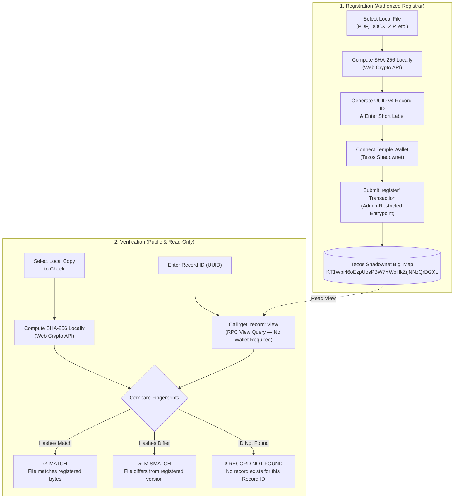

# Document Integrity Registry

[](https://teztnets.com/shadownet-about)
[](https://smartpy.io)
[](https://tezostaquito.io)
[](https://vitejs.dev)
[]()

A decentralized, privacy-first web application designed for student clubs, research groups, and project teams. It allows an authorized team administrator to record a document's SHA-256 cryptographic fingerprint and label on the **Tezos Shadownet** testnet. Later, anyone holding a copy of the document can select it in their browser and enter the assigned **Record ID** to verify whether its byte content matches the registered version.

---

## Table of Contents

- [Overview & Core Principles](#overview--core-principles)
- [How It Works](#how-it-works)
  - [Cryptographic Flowchart](#cryptographic-flowchart)
- [System Architecture](#system-architecture)
  - [Smart Contract Specification](#smart-contract-specification)
  - [On-Chain Configuration](#on-chain-configuration)
- [User Workflows](#user-workflows)
  - [1. Document Registration](#1-document-registration)
  - [2. Document Verification](#2-document-verification)
- [Verification Outcomes](#verification-outcomes)
- [Important Limits & Non-Goals](#important-limits--non-goals)
- [Getting Started](#getting-started)
  - [Prerequisites](#prerequisites)
  - [Installation](#installation)
  - [Environment Configuration](#environment-configuration)
  - [Running the Website](#running-the-website)
  - [Running Tests & Type Checking](#running-tests--type-checking)
- [Deep Dive & Technical Details](#deep-dive--technical-details)
  - [Browser-Side Cryptography](#browser-side-cryptography)
  - [Dual Wallet Integration & Polyfills](#dual-wallet-integration--polyfills)
  - [SmartPy Contract Code & Compilation](#smartpy-contract-code--compilation)
- [Troubleshooting & FAQ](#troubleshooting--faq)
- [Repository Structure](#repository-structure)
- [License](#license)

---

<a id="overview--core-principles"></a>
## Overview & Core Principles

When teams share bylaws, contest submissions, project charters, whitepapers, or code deliverables, team members often need to know whether a circulating PDF or archive is identical to the authoritative revision.

The **Document Integrity Registry** solves this problem with three core guarantees:

1. **Zero File Uploads (Complete Privacy)**: The selected file never leaves your browser. Files are read locally using the browser's native `File` API and hashed in memory using the W3C standard `crypto.subtle.digest('SHA-256')`. File bytes are never uploaded, persisted, cached, or transmitted to any server or blockchain.
2. **Authoritative On-Chain Anchor**: Only the 64-character lowercase hexadecimal fingerprint, a short label, the unique UUID Record ID, the registrar's public address, and the registration timestamp are stored in the smart contract's `big_map` on Tezos Shadownet.
3. **Wallet-Free Verification**: Checking a document is completely read-only. Anyone can verify a file in seconds without connecting a wallet, installing an extension, holding test tez, or signing transactions.

---

## How It Works

### Cryptographic Flowchart



---

## System Architecture

The application consists of a single-page React client talking directly to the Tezos Shadownet RPC and the deployed SmartPy contract.

```
┌────────────────────────────────────────────────────────┐
│                   Browser Client                       │
│                                                        │
│  React 18 + Vite UI    ──▶    Web Crypto API (SHA-256) │
│           │                                            │
│           ▼                                            │
│  tezosAdapter.ts       ──▶    Taquito / Beacon / Temple│
└───────────┬────────────────────────────────────────────┘
            │
            │ Direct RPC (HTTPS)
            ▼
┌────────────────────────────────────────────────────────┐
│              Tezos Shadownet Testnet                   │
│                                                        │
│  SmartPy Contract: KT1Wpi46oEzpUosPBW7YWoHkZrjNNzQrDGXL│
│  - Entrypoint: register(record_id, label, sha256)      │
│  - On-Chain View: get_record(record_id)                │
└────────────────────────────────────────────────────────┘
```

### Smart Contract Specification

The contract is written in [SmartPy](https://smartpy.io) and originated to Tezos Shadownet:

- **Source Code**: [`contracts/document_registry.py`](contracts/document_registry.py)
- **Contract Address**: `KT1Wpi46oEzpUosPBW7YWoHkZrjNNzQrDGXL`
- **Configured Registrar Admin**: `tz1dmo2H7rmwf8KGx11oQhqHda51iE6t1das`
- **Write Entrypoint**: `register(params: record(record_id: string, label: string, sha256: string))`
  - Restricts execution strictly to `sp.sender == self.data.admin`.
  - Prevents record collisions (`assert not (params.record_id in self.data.records)`).
  - Persists `{ label, sha256, registrar, registered_at }`.
- **Read-Only On-Chain View**: `get_record(record_id: string) -> sp.option[record_type]`
  - Queries `self.data.records.get_opt(record_id)`.
  - Returns `Some(record)` when the record exists, or `None` if unknown.

### On-Chain Configuration

Configuration settings are centralized in [`src/config/tezos.ts`](src/config/tezos.ts) and populated via environment variables:

| Setting | Variable Name | Default / Shadownet Value |
| :--- | :--- | :--- |
| **Network** | `VITE_TEZOS_NETWORK` | `shadownet` |
| **RPC URL** | `VITE_TEZOS_RPC_URL` | `https://rpc.shadownet.teztnets.com` |
| **Contract Address** | `VITE_DOCUMENT_REGISTRY_ADDRESS` | `KT1Wpi46oEzpUosPBW7YWoHkZrjNNzQrDGXL` |
| **Admin Address** | `VITE_DOCUMENT_REGISTRY_ADMIN_ADDRESS` | `tz1dmo2H7rmwf8KGx11oQhqHda51iE6t1das` |

---

## User Workflows

### 1. Document Registration

Registration allows authorized team leads or registrars to record a document's fingerprint:

1. **Select Document**: Pick any local file via file picker or drag-and-drop.
2. **Local Fingerprint**: The browser immediately calculates the 64-character SHA-256 fingerprint.
3. **Auto-Generated Record ID**: A standard UUID v4 (e.g., `4fa9c680-e387-4340-a337-128a30ef1d2f`) is created automatically.
4. **Enter Label**: Enter a short label describing the document (up to 100 printable ASCII characters, e.g., `Club Constitution v2.1`).
5. **Connect Temple Wallet**: Connect Temple wallet configured to **Tezos Shadownet**. The UI verifies that your connected account matches the on-chain registrar admin address (`tz1dmo2H7rmwf8KGx11oQhqHda51iE6t1das`).
6. **Sign Transaction**: Click **Register on Tezos Shadownet**. Temple wallet prompts you to approve the `register` invocation.
7. **Confirmation & Receipt**: Once confirmed on-chain (1 block confirmation), the confirmed Record ID, fingerprint, transaction hash, registrar address, and timestamp are displayed with convenient copy buttons.

### 2. Document Verification

Verification enables anyone to verify whether a given document matches a registered version:

1. **Select File to Verify**: Choose the document file to test.
2. **Enter Record ID**: Paste the UUID Record ID received from the team.
3. **Instant Verification**: Click **Verify Document**.
4. The application computes the file's SHA-256 digest locally, queries the contract's `get_record` view via RPC, and compares the two digests.

---

## Verification Outcomes

The application reports exactly one of three distinct outcomes:

| Outcome | Visual Badge | Explanation |
| :--- | :--- | :--- |
| **MATCH** | 🟢 **MATCH** | The Record ID exists, and the selected file's calculated SHA-256 digest is **identical** to the registered fingerprint. |
| **MISMATCH** | 🟠 **MISMATCH** | The Record ID exists, but the selected file's SHA-256 digest **differs** from the stored fingerprint. This file is not identical to the registered version. |
| **RECORD NOT FOUND** | ⚪ **RECORD NOT FOUND** | No registration exists for the provided Record ID. The user is invited to check the Record ID for typographical errors. |

> [!NOTE]
> An unknown Record ID is **never** classified as a mismatch. Mismatch occurs strictly when a valid record exists on-chain with a different fingerprint.

---

<a id="important-limits--non-goals"></a>
## Important Limits & Non-Goals

To maintain security and trust, the following boundaries are enforced:

- **What a Match Proves**: A cryptographic match proves **strictly** that the selected file contains the exact same bytes as the file used to generate the registered fingerprint.
- **What a Match Does NOT Prove**:
  - It does **not** prove who authored, created, or originally wrote the document.
  - It does **not** certify that the document content is safe, accurate, legal, or officially approved.
  - It does **not** detect whether a file is "counterfeit" or malicious.
- **Privacy Enforcement**: Document contents are **never** uploaded to a server, IPFS, or Tezos. Only metadata (fingerprint, label, UUID, timestamp) is registered.
- **Architectural Scope**: The project deliberately excludes user accounts, logins, file hosting, IPFS pinning, machine learning, and document editing.

---

## Getting Started

### Prerequisites

- [Node.js](https://nodejs.org/) v18.0.0 or higher
- [npm](https://www.npmjs.com/) v9.0.0 or higher
- [Temple Wallet](https://templewallet.com/) browser extension (Chrome, Brave, Edge, or Firefox) with **Testnet Mode** enabled and connected to **Tezos Shadownet**.

### Installation

Clone the repository and install dependencies:

```bash
git clone https://github.com/Prasanna-Ram-SJ/document-integrity-registry.git
cd document-integrity-registry
npm install
```

### Environment Configuration

The repository includes a template file [` .env.example`](.env.example). Create your local `.env`:

```bash
cp .env.example .env
```

Ensure `.env` contains the deployed Shadownet contract details:

```env
VITE_TEZOS_NETWORK=shadownet
VITE_TEZOS_RPC_URL=https://rpc.shadownet.teztnets.com
VITE_DOCUMENT_REGISTRY_ADDRESS=KT1Wpi46oEzpUosPBW7YWoHkZrjNNzQrDGXL
VITE_DOCUMENT_REGISTRY_ADMIN_ADDRESS=tz1dmo2H7rmwf8KGx11oQhqHda51iE6t1das
```

> [!IMPORTANT]
> Never put private keys, seed phrases, passwords, or secrets into `.env` or any project file. The `.env` file is excluded from Git via `.gitignore`.

### Running the Website

<details>
<summary><strong>View package scripts and execution modes</strong></summary>

The project supports the following scripts defined in [`package.json`](package.json):

#### 1. Development Server
Starts Vite with hot module replacement:
```bash
npm run dev
```
Default URL: `http://localhost:5173/`

#### 2. Production Build
Compiles TypeScript and builds minified production assets into `dist/`:
```bash
npm run build
```

#### 3. Production Preview Server
Serves the compiled `dist/` directory locally:
```bash
npm run preview
```
Default URL: `http://localhost:4173/`

</details>

<a id="running-tests--type-checking"></a>
### Running Tests & Type Checking

The test suite covers SHA-256 hash formatting, UUID validation, label constraints, option record normalization, match/mismatch/not-found logic, and live Shadownet RPC on-chain view queries:

```bash
# Run Vitest test suite once (20 tests)
npm run test

# Run tests in watch mode
npm run test:watch

# Run TypeScript type check (strict, no emit)
npm run typecheck
```

---

<a id="deep-dive--technical-details"></a>
## Deep Dive & Technical Details

<a id="browser-side-cryptography"></a>
<details>
<summary><strong>Browser-Side Cryptography (Web Crypto API)</strong></summary>

Fingerprints are computed entirely inside the browser using standard web standards implemented in [`src/services/crypto.ts`](src/services/crypto.ts):

```typescript
export async function computeFileSha256(file: File): Promise<string> {
  const arrayBuffer = await file.arrayBuffer();
  const digestBuffer = await window.crypto.subtle.digest('SHA-256', arrayBuffer);
  const hashArray = Array.from(new Uint8Array(digestBuffer));
  return hashArray.map((b) => b.toString(16).padStart(2, '0')).join('').toLowerCase();
}
```

- Input: `File` object from `<input type="file">` or Drag-and-Drop.
- Output: A normalized string containing exactly 64 lowercase hexadecimal characters `[0-9a-f]{64}`.

</details>

<a id="dual-wallet-integration--polyfills"></a>
<details>
<summary><strong>Dual Wallet Integration & Browser Polyfills</strong></summary>

Connecting Temple Wallet on Vite requires addressing browser compatibility differences between Node.js packages and browser ESM environments:

1. **Dual Wallet Strategy** in [`src/services/tezosAdapter.ts`](src/services/tezosAdapter.ts):
   - First checks `@temple-wallet/dapp`'s direct extension provider (`TempleWallet.isAvailable()`).
   - Falls back gracefully to `@taquito/beacon-wallet` (`BeaconWallet.requestPermissions()`).
2. **Buffer Polyfill** in [`src/polyfills/buffer.ts`](src/polyfills/buffer.ts):
   - `@airgap/beacon-dapp` internally requires `Buffer.from()` during secret initialization (`loadOrCreateBeaconSecret`).
   - The polyfill attaches `Buffer` to `window.Buffer` and `globalThis.Buffer` in browser runtimes while preserving native Node.js buffers in test environments.
3. **Crypto Polyfill** in [`src/polyfills/crypto.ts`](src/polyfills/crypto.ts):
   - Aliased in [`vite.config.ts`](vite.config.ts) to eliminate Vite externalization warnings for packages importing Node's built-in `crypto` module.

</details>

<a id="smartpy-contract-code--compilation"></a>
<details>
<summary><strong>SmartPy Contract Code & Compilation</strong></summary>

The smart contract [`contracts/document_registry.py`](contracts/document_registry.py) is authored in SmartPy (v0.24+):

- **Data Structure**:
  ```python
  self.data.records = sp.cast(sp.big_map(), sp.big_map[sp.string, record_type])
  ```
- **Entrypoint Logic**:
  ```python
  @sp.entrypoint
  def register(self, params: register_params_type):
      sp.cast(params, register_params_type)
      assert sp.sender == self.data.admin, "UNAUTHORIZED: Sender is not admin"
      assert not (params.record_id in self.data.records), "RECORD_EXISTS: Record ID already registered"
      self.data.records[params.record_id] = sp.record(
          label=params.label,
          sha256=params.sha256,
          registrar=sp.sender,
          registered_at=sp.now,
      )
  ```
- **View Logic**:
  ```python
  @sp.onchain_view()
  def get_record(self, record_id: sp.string) -> sp.option[record_type]:
      return self.data.records.get_opt(record_id)
  ```
- **Tests**: Includes automated simulation scenario `DocumentRegistry_Tests` validating admin authorization, duplicate rejection, and missing record handling.

</details>

---

<a id="troubleshooting--faq"></a>
## Troubleshooting & FAQ

<details>
<summary><strong>How do I get Tezos Shadownet test tez?</strong></summary>

To register documents, your admin account needs testnet tez for gas:
1. Open [Tezos Shadownet Faucet](https://teztnets.com/shadownet-about).
2. Request test tez to your public Temple address (`tz1...`).
3. Transactions on Shadownet confirm in roughly 8 to 15 seconds.

</details>

<details>
<summary><strong>Why does wallet connection prompt for Temple / Beacon?</strong></summary>

The website supports both Temple's direct browser provider and Beacon. If Temple extension is installed and unlocked with Shadownet enabled, clicking **Connect Temple wallet** will open Temple's permission dialog. If the Beacon modal appears, simply click **Temple Wallet** to open the popup.

</details>

<details>
<summary><strong>Why does verification work without connecting my wallet?</strong></summary>

Verification uses Tezos on-chain views (`get_record`). On-chain views are read-only queries executed against the public Tezos RPC node (`https://rpc.shadownet.teztnets.com`). Because read queries do not modify state or consume tez, no signature, wallet connection, or transaction fee is required.

</details>

---

## Repository Structure

```
.
├── contracts/
│   └── document_registry.py       # SmartPy contract source & test scenarios
├── public/
│   └── favicon.svg                # Application favicon
├── src/
│   ├── components/                # Modular React visual components
│   │   ├── FactualStrip.tsx       # Core architectural principles banner
│   │   ├── Footer.tsx             # Network, contract, and security footer
│   │   ├── Header.tsx             # Sticky navbar, brand, and wallet controls
│   │   ├── Hero.tsx               # Hero copy and SVG cryptographic flow diagram
│   │   ├── HowItWorks.tsx         # Dark 4-step process cards
│   │   ├── LimitationNotice.tsx   # Meaning and limitations of hash matches
│   │   ├── RegisterSection.tsx    # Admin document registration panel
│   │   └── VerifySection.tsx      # Read-only verification panel & diff outcomes
│   ├── config/
│   │   └── tezos.ts               # Centralized Tezos network & contract configuration
│   ├── polyfills/
│   │   ├── buffer.ts              # Browser Buffer polyfill for Beacon SDK
│   │   └── crypto.ts              # Web Crypto fallback polyfill
│   ├── services/
│   │   ├── crypto.ts              # Local SHA-256 calculation & UUID generation
│   │   └── tezosAdapter.ts        # Typed Taquito/Beacon/Temple on-chain adapter
│   ├── test/
│   │   ├── adapter.test.ts        # Contract normalization & live RPC tests
│   │   └── crypto.test.ts         # SHA-256 and UUID unit tests
│   ├── types/
│   │   └── registry.ts            # TypeScript interfaces and result types
│   ├── App.tsx                    # Root application component & tab switcher
│   ├── index.css                  # Design tokens, typography & component styling
│   └── main.tsx                   # React DOM application entrypoint
├── .env.example                   # Environment configuration template
├── .gitignore                     # Git ignore rules (excludes .env, secrets, build)
├── Gemini.md                      # Project requirements specification
├── guidelines.md                  # Visual system & architectural guidelines
├── index.html                     # HTML5 shell & Google Fonts imports
├── package.json                   # Project dependencies and npm scripts
├── tsconfig.json                  # TypeScript compiler configuration
└── vite.config.ts                 # Vite bundler configuration & polyfill aliases
```

---

## License

This project is licensed under the [MIT License](LICENSE).
